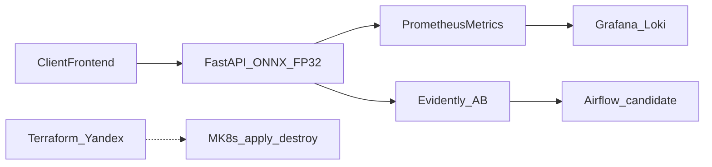

# credit-scoring-mlops-deployment

**Промышленное развёртывание кредитной скоринговой системы с полным MLOps-циклом**

Учебный итоговый проект по дисциплине «Автоматизация процессов доставки и развертывания моделей машинного обучения».

[](https://github.com/Serg2311-prog/credit-scoring-mlops-deployment/actions/workflows/ci-python.yml)
[](https://github.com/Serg2311-prog/credit-scoring-mlops-deployment/actions/workflows/ci-docker.yml)
[](https://github.com/Serg2311-prog/credit-scoring-mlops-deployment/actions/workflows/ci-infrastructure.yml)
[](https://github.com/Serg2311-prog/credit-scoring-mlops-deployment/actions/workflows/ci-kubernetes.yml)
[](https://github.com/Serg2311-prog/credit-scoring-mlops-deployment/actions/workflows/ci-airflow-dag.yml)

| | |
| --- | --- |
| Репозиторий | [github.com/Serg2311-prog/credit-scoring-mlops-deployment](https://github.com/Serg2311-prog/credit-scoring-mlops-deployment) |
| Последний проверенный CI baseline | [`978bf8e`](https://github.com/Serg2311-prog/credit-scoring-mlops-deployment/commit/978bf8e) |
| Локальные тесты | `pytest -m "not k8s and not e2e"` — **236 passed, 2 skipped** |
| Cloud experiment | инфраструктура **создана и уничтожена** (MK8s v1.34.1); приложение в облаке **не** развёртывалось |
| Serving default | ONNX Runtime **CPU FP32** |
| Auto-promote challenger | **`false`** |

Исходный ML-проект: [credit-default-prediction](https://github.com/Serg2311-prog/credit-default-prediction).

---

## Постановка задачи

Кредитный скоринг (UCI / Taiwan credit card default) переведён из notebook-контура в воспроизводимый MLOps-контур: обучение → ONNX → API → контейнеры/K8s → IaC → CI/CD → observability → drift/A/B → Airflow retraining — **без фиктивных метрик и без неподтверждённого cloud production deploy**.

## Цель и результаты

- PyTorch MLP на той же схеме признаков, что и исторический RF baseline.
- Production-кандидат инференса: **ONNX FP32** (parity с PyTorch; test ROC-AUC **0.7742**).
- RF baseline test ROC-AUC **0.7771** (не подменяется).
- Dynamic INT8 quantization — **экспериментальный** артефакт (не auto-champion).
- Локально: Docker Compose, kind/Kustomize, Prometheus/Grafana/Loki, drift, online A/B, Airflow Docker E2E.
- CI на `main` (commit `978bf8e`): quality gates, Docker/Trivy, Terraform validate, Kubernetes **manifest validation** (kubeconform/kustomize); **optional kind smoke** — только `workflow_dispatch` с `run_kind_smoke=true`, по умолчанию **skipped**. Airflow DAG import.
- Облачная инфраструктура (Yandex Managed Kubernetes): Apply + Remote State — runtime-проверены, затем destroy verified. Развёртывание ML-приложения в облаке — **не выполнялось** (`ABORT_CLOUD_APP`).

Сводный отчёт: [`docs/final_project_report.md`](docs/final_project_report.md). Облако: [`results/block11/FINAL_CLOUD_EXPERIMENT_REPORT.md`](results/block11/FINAL_CLOUD_EXPERIMENT_REPORT.md). Оценка: [`results/block11/FINAL_PROJECT_SCORECARD.md`](results/block11/FINAL_PROJECT_SCORECARD.md).

---

## Архитектура



Подробные диаграммы: [`docs/architecture/overview.md`](docs/architecture/overview.md).

## Технологический стек

| Слой | Стек |
| --- | --- |
| ML | PyTorch, scikit-learn, ONNX Runtime, Evidently |
| API / UI | FastAPI, nginx frontend |
| Data | DVC, Pandera |
| Containers | Docker multi-stage, Compose |
| K8s | kind, Kustomize, Ingress, NetworkPolicy |
| IaC | Terraform (Yandex Cloud) |
| CI/CD | GitHub Actions, Trivy, kubeconform |
| Observability | Prometheus, Grafana, Loki, Alloy, Alertmanager |
| Retraining | Apache Airflow 2.9.x DAG |

## Датасет и артефакты моделей

- **UCI Credit Card Default** (Taiwan); в Git нет реальных PII клиентов.
- DVC: `dvc.yaml` / `dvc.lock` (local remote `.dvc_remote/`, gitignored).
- **Production** ONNX/PT/preprocessor — **gitignored**; SHA256 — [`docs/instructor_model_pack.md`](docs/instructor_model_pack.md).
- **Synthetic** (CI / чистый клон без production-файлов): `scripts/ci/generate_synthetic_artifacts.py` — **не** совпадают с production SHA256. Не использовать `--force`, если в `models/` уже лежат production-артефакты.

## Структура репозитория

```text
src/  models/  frontend/  docker/  k8s/  infra/terraform/
monitoring/  airflow_home/dags/  configs/  docs/  results/
scripts/  tests/  .github/workflows/
```

## Системные требования

| Режим | Минимум |
| --- | --- |
| Unit tests | Python 3.11+, ~4 GB RAM |
| API + frontend Compose | Docker Desktop, ~4–6 GB свободно |
| Observability | +~2 GB; не параллелить с Airflow на 8 GB |
| Local kind E2E | Docker + kubectl; NetworkPolicy enforcement на kindnet **не подтверждён** |
| GPU benchmark | evidence в `results/block7/colab/hardened/` |

---

## Быстрый старт

### Windows PowerShell

```powershell
git clone https://github.com/Serg2311-prog/credit-scoring-mlops-deployment.git
cd credit-scoring-mlops-deployment
python -m venv .venv
.\.venv\Scripts\Activate.ps1
python -m pip install -U pip
pip install -r requirements.txt -r requirements-dev.txt -r requirements-api.txt -r requirements-nn.txt
$env:PYTHONPATH = (Get-Location).Path

# Synthetic artifacts — только для чистого клона без production ONNX/joblib.
# Скрипт без --force не перезапишет существующие non-synthetic models/*.
if (-not (Test-Path models\credit_scoring_nn.onnx)) {
  python scripts/ci/generate_synthetic_artifacts.py --output-dir models
}

python -m pytest -m "not k8s and not e2e" -q
```

### Linux / Bash

```bash
git clone https://github.com/Serg2311-prog/credit-scoring-mlops-deployment.git
cd credit-scoring-mlops-deployment
python3 -m venv .venv
source .venv/bin/activate
pip install -U pip
pip install -r requirements.txt -r requirements-dev.txt -r requirements-api.txt -r requirements-nn.txt
export PYTHONPATH="$PWD"

# Synthetic artifacts — only when production ONNX is absent.
# Do not pass --force if production models/ files are present.
if [ ! -f models/credit_scoring_nn.onnx ]; then
  python scripts/ci/generate_synthetic_artifacts.py --output-dir models
fi

python -m pytest -m "not k8s and not e2e" -q
```

---

## Для преподавателя

1. [`docs/quick_review.md`](docs/quick_review.md) и [`docs/requirements_matrix.md`](docs/requirements_matrix.md).
2. CI badges на `main` / commit `978bf8e`.
3. `pytest -m "not k8s and not e2e" -q`.
4. Production-parity: [`docs/instructor_model_pack.md`](docs/instructor_model_pack.md).
5. Облако: [`results/block11/FINAL_CLOUD_EXPERIMENT_REPORT.md`](results/block11/FINAL_CLOUD_EXPERIMENT_REPORT.md) — infra apply→destroy; app не развёртывалось.
6. Scorecard: [`results/block11/FINAL_PROJECT_SCORECARD.md`](results/block11/FINAL_PROJECT_SCORECARD.md).
7. Monitoring / drift / A/B: [`results/block8/`](results/block8/); benchmarks: [`results/block7/`](results/block7/).

---

## API и Compose

```powershell
$env:PYTHONPATH = (Get-Location).Path
uvicorn src.api.main:app --host 127.0.0.1 --port 8000
```

Контракт: [`docs/api_contract.md`](docs/api_contract.md).

```powershell
docker compose up -d --build   # UI :8081
docker compose down
```

## Локальные контуры (инструкции)

| Контур | Документация |
| --- | --- |
| Kubernetes (kind) | [`docs/kubernetes_local_deployment.md`](docs/kubernetes_local_deployment.md), [`k8s/README.md`](k8s/README.md) |
| DVC | [`dvc.yaml`](dvc.yaml), [`docs/docker_deployment.md`](docs/docker_deployment.md) |
| Monitoring | [`docs/stage5_runbook.md`](docs/stage5_runbook.md), [`docs/architecture/observability.md`](docs/architecture/observability.md) |
| Drift / A/B | [`docs/stage6_runbook.md`](docs/stage6_runbook.md), [`docs/stage6_drift_completion_report.md`](docs/stage6_drift_completion_report.md) |
| Airflow | [`docs/stage7_runbook.md`](docs/stage7_runbook.md), [`docs/stage7_airflow_e2e_report.md`](docs/stage7_airflow_e2e_report.md) |
| Terraform | [`docs/terraform_infrastructure.md`](docs/terraform_infrastructure.md) |
| CI/CD | [`docs/cicd_pipeline.md`](docs/cicd_pipeline.md) |

Локальный kind E2E (отдельно от CI): `.\scripts\k8s_create.ps1`, `.\scripts\k8s_ingress_e2e.ps1`.

## CI/CD и тестирование

```powershell
.\scripts\ci\check.ps1
python -m pytest -m "not k8s and not e2e" -q
python -m black --check src tests scripts/ci airflow_home/dags
python -m flake8 src tests scripts/ci airflow_home/dags
```

## CPU / GPU benchmark

| Контур | Статус | Evidence |
| --- | --- | --- |
| CPU model_only + quality | VERIFIED_LOCAL | `results/block7/`, `docs/model_benchmark.md` |
| API HTTP load (synthetic) | VERIFIED_LOCAL | `results/block7/api_load_summary.json` |
| GPU Colab Tesla T4 | VERIFIED_GPU | `results/block7/colab/hardened/` |
| GPU INT8 / GPU HTTP load | **не выполнялись** | — |

Не смешивать model-only throughput с HTTP throughput; не смешивать synthetic GPU latency с holdout quality.

## Безопасность

- Trivy gate в CI Docker: CRITICAL/HIGH, **`ignore-unfixed: true`** (как в `ci-docker.yml`).
- Secrets не в Git; `.env.example` без реальных ключей.
- Terraform backends — credentials **только через env** (`AWS_ACCESS_KEY_ID` / `AWS_SECRET_ACCESS_KEY`), не через CLI `-backend-config=access_key/secret_key`.

## Ограничения проекта

- Облачная инфраструктура эксперимента создана и уничтожена; **ML-приложение в облаке не развёртывалось**.
- Отображённое потребление гранта (~50 RUB) — предварительный UI, не финальный биллинг.
- Удаление последнего SA / отзыв PAT / полная очистка локальных credentials — не утверждаются без отдельного подтверждения оператора.
- Production Terraform env не развёрнут; GPU node group в облаке не запускалась.
- NetworkPolicy на kind — manifests есть; runtime enforcement не подтверждён.
- Online A/B и concept-drift — synthetic/controlled experiments ≠ production traffic proof.
- Airflow E2E — локальный Docker, не managed cloud.

---

## Документация и evidence

| Документ | Назначение |
| --- | --- |
| [`docs/final_project_report.md`](docs/final_project_report.md) | Сводный отчёт |
| [`docs/requirements_matrix.md`](docs/requirements_matrix.md) | Матрица ТЗ |
| [`docs/evidence_index.md`](docs/evidence_index.md) | Индекс доказательств |
| [`docs/quick_review.md`](docs/quick_review.md) | Обзор для преподавателя |
| [`docs/defense_guide.md`](docs/defense_guide.md) | Подготовка к защите |
| [`docs/architecture/overview.md`](docs/architecture/overview.md) | Архитектура |
| [`docs/instructor_model_pack.md`](docs/instructor_model_pack.md) | Production model pack |
| [`results/block11/FINAL_PROJECT_SCORECARD.md`](results/block11/FINAL_PROJECT_SCORECARD.md) | Итоговая оценка |
| [`results/block7/`](results/block7/) | CPU/GPU/API load |
| [`results/block8/`](results/block8/) | Monitoring / drift / A/B |
| [`results/block11/`](results/block11/) | Cloud experiment closure |
