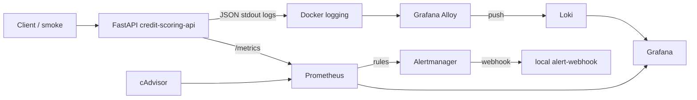

# Observability Architecture (Stage 5)

Local-only stack. No cloud exporters, no paid SaaS.

## Components

| Component | Role | Image pin |
| --- | --- | --- |
| API | Existing ONNX inference service | `credit-scoring-api:stage2` (built) |
| Prometheus | Scrape API + cAdvisor; evaluate alerts | `prom/prometheus:v3.2.1` |
| Alertmanager | Route alerts locally | `prom/alertmanager:v0.28.1` |
| alert-webhook | Credential-free webhook sink | local build |
| Loki | Log store (72h retention) | `grafana/loki:3.4.2` |
| Alloy | Docker log shipper → Loki | `grafana/alloy:v1.7.5` |
| Grafana | Dashboards (provisioned) | `grafana/grafana:11.5.2` |
| cAdvisor | Container CPU/memory | `gcr.io/cadvisor/cadvisor:v0.49.2` |

## Metrics (application)

Reused / extended from `src/api/metrics.py`:

- `credit_scoring_http_requests_total`
- `credit_scoring_http_errors_total`
- `credit_scoring_http_request_latency_seconds` (p50/p95/p99 via histogram_quantile)
- `credit_scoring_inference_requests_total`
- `credit_scoring_inference_latency_seconds`
- `credit_scoring_batch_size`
- `credit_scoring_model_ready`

## Logs

Structured JSON from `src/api/logging_config.py` → container stdout → Alloy → Loki.  
Fields: `timestamp`, `level`, `service`, `request_id`, … without request bodies or secrets.

## Compose layout

- `docker-compose.yml` — API  
- `docker-compose.observability.yml` — observability services  
- Shared project network `credit-scoring-net`
