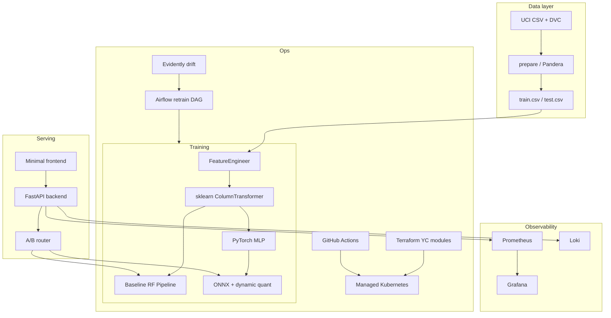

# Архитектура (черновик этапа 0)

Провайдер IaC: **Yandex Cloud**.  
Инференс по умолчанию (целевой): **ONNX Runtime CPU**.  
Baseline сравнения: **RandomForest** из исходного проекта (метрики зафиксированы исторически).

Подробный план: [`../implementation_plan.md`](../implementation_plan.md).  
Матрица требований: [`../requirements_matrix.md`](../requirements_matrix.md).
