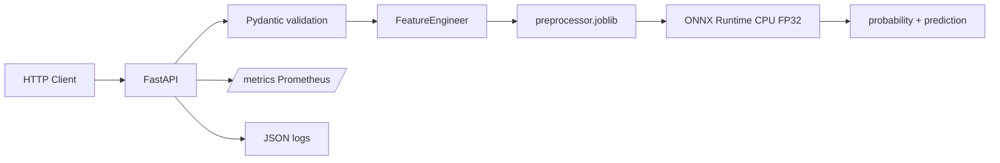
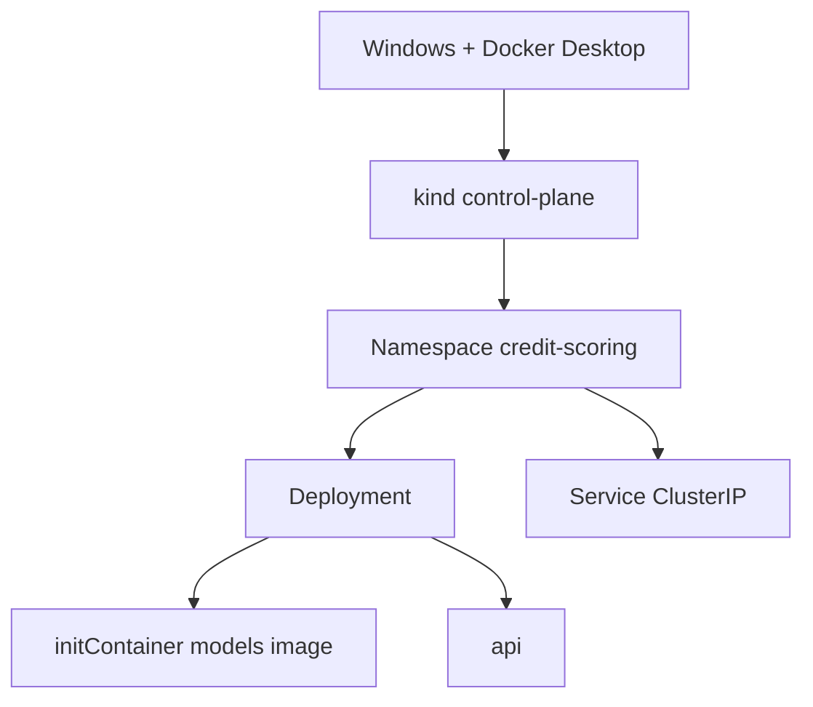
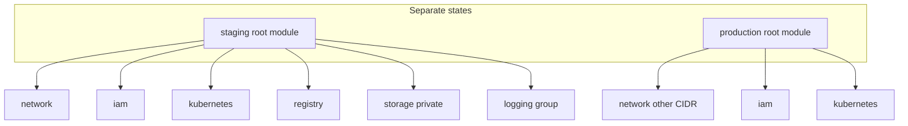
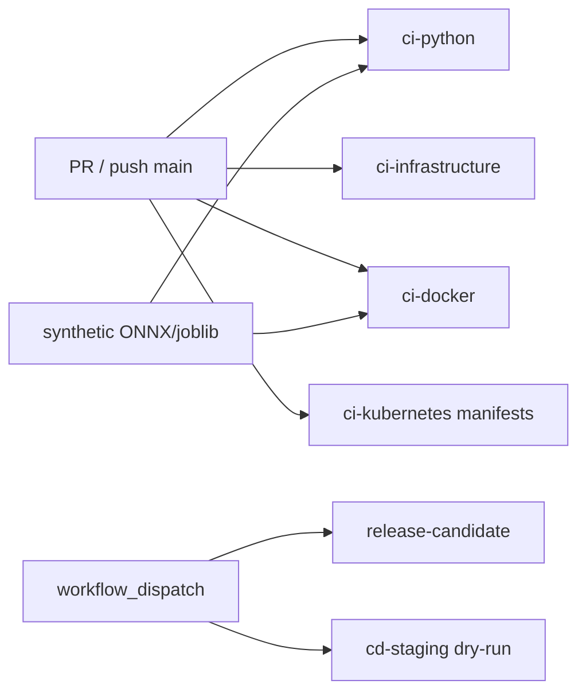

# Архитектура

Провайдер IaC: **Yandex Cloud** (Terraform подготовлен на этапе 3Б; **apply не выполнялся**).
CI/CD: GitHub Actions workflows (этап 4); cloud deploy — только dry-run gate.
Инференс: **ONNX Runtime CPU FP32**.
Baseline качества: RandomForest (исторический).

## Stage 2 — Inference path

## Stage 3A — Local Kubernetes (kind)

## Stage 3B — Terraform (Yandex Cloud, code only)

- Модули: `infra/terraform/modules/{network,iam,kubernetes,registry,storage,monitoring}`
- Окружения: `infra/terraform/environments/{staging,production}`
- Секреты только через env / gitignored tfvars
- Будущий scrape `/metrics` — отдельный агент/Prometheus (не автоматом Yandex Monitoring)

## Stage 4 — CI/CD

Подробности: [`../cicd_pipeline.md`](../cicd_pipeline.md), [`../terraform_infrastructure.md`](../terraform_infrastructure.md)
