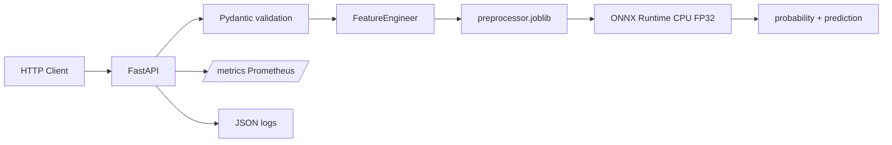
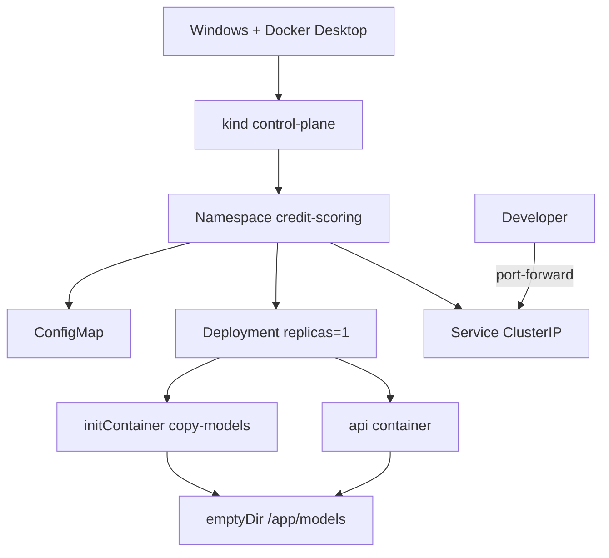

# Архитектура

Провайдер IaC (позже): **Yandex Cloud** (пока только план).  
Инференс: **ONNX Runtime CPU FP32**.  
Baseline качества: RandomForest (исторический).

## Stage 2 — Inference path

Локальный Docker Compose поднимает только API (+ volume с артефактами).

## Stage 3A — Local Kubernetes (kind)

- Образы: `credit-scoring-api:stage3a`, `credit-scoring-models:stage3a` (kind load).
- Без Ingress / mesh / cloud / Prometheus Operator.
- Probes: live → liveness/startup; ready → readiness.
- Overlay: `k8s/overlays/local`.

Подробности API: [`../api_contract.md`](../api_contract.md)  
Docker: [`../docker_deployment.md`](../docker_deployment.md)  
Kubernetes: [`../kubernetes_local_deployment.md`](../kubernetes_local_deployment.md)
