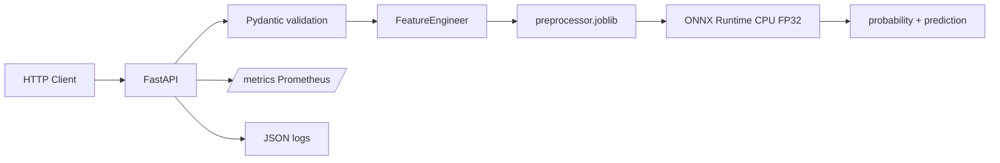

# Архитектура

Провайдер IaC (этап 2+): **Yandex Cloud** (пока только план).  
Инференс: **ONNX Runtime CPU FP32**.  
Baseline качества: RandomForest (исторический).

## Stage 2 — Inference path

Локальный Docker Compose поднимает только API (+ volume с артефактами).  
Observability stack / K8s / Terraform — следующие этапы.

Подробности API: [`../api_contract.md`](../api_contract.md)  
Docker: [`../docker_deployment.md`](../docker_deployment.md)
