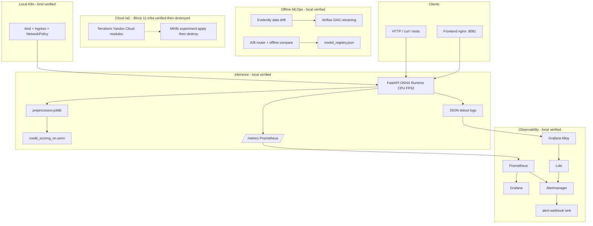
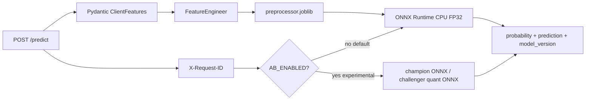
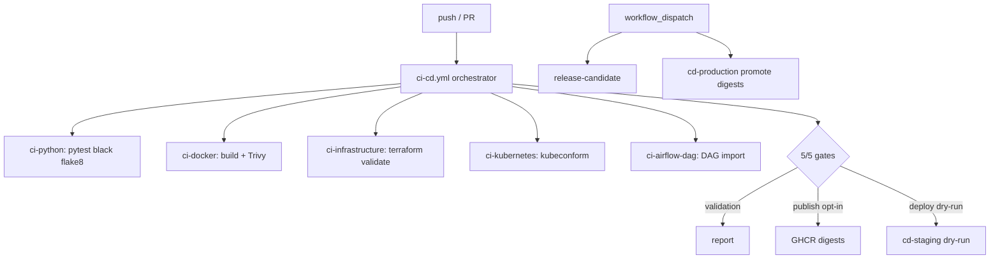
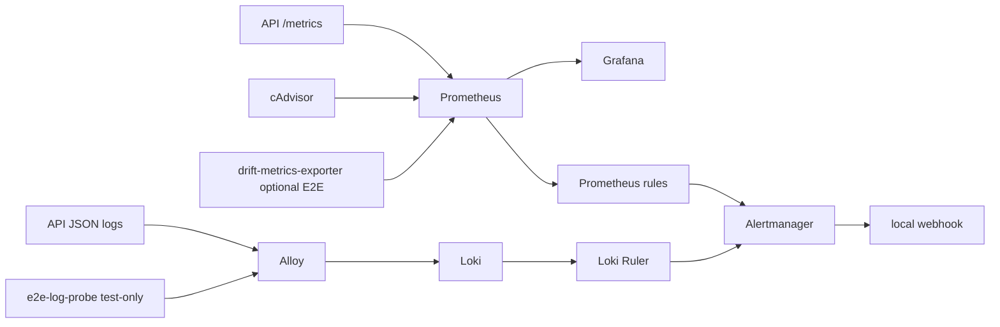
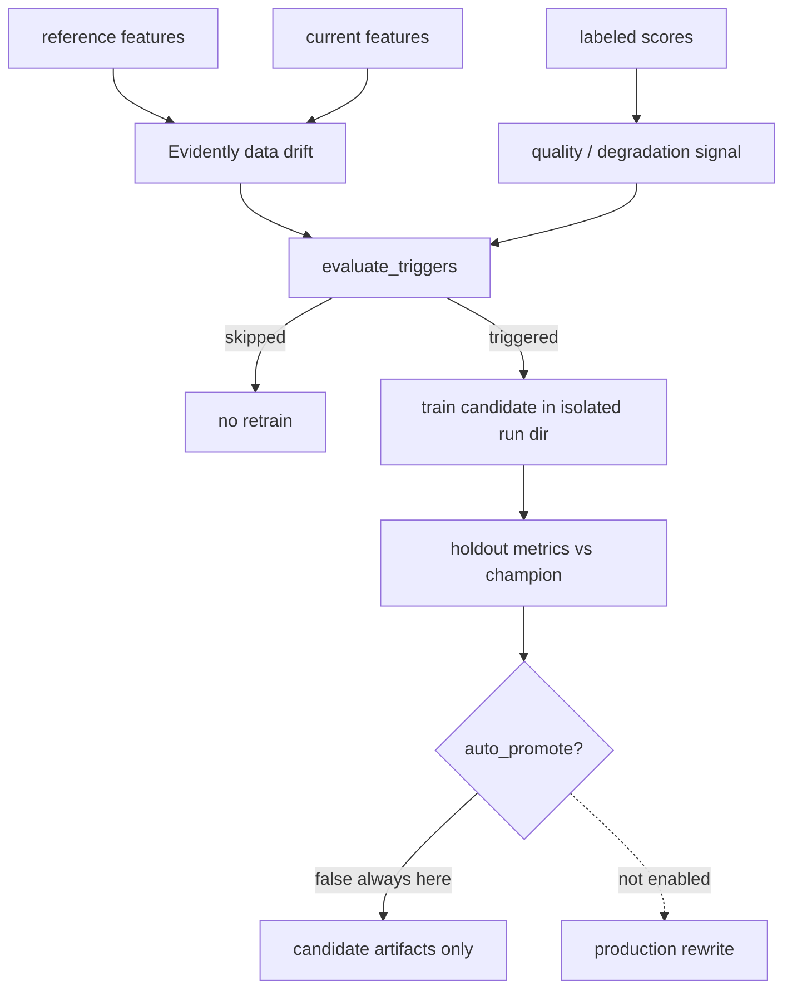
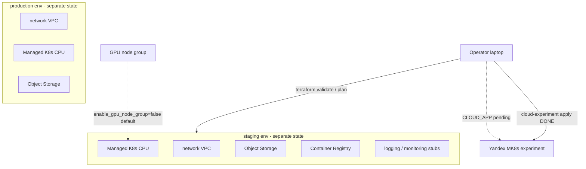
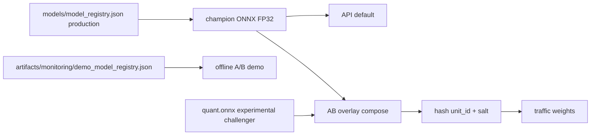

# Архитектура системы

**Проект:** credit-scoring-mlops-deployment
**Тема:** промышленное развёртывание кредитной скоринговой системы с полным MLOps-циклом
**Документационный baseline релиза:** commit `5527a55` / tag `v1.0.0` (исторические Block 9 формулировки ниже обновлены по фактам Block 11).

Документ описывает **фактически реализованные** компоненты.

Уровни проверки: **STATIC / LOCAL / CLOUD_INFRA / CLOUD_APP / OPS**.
**CLOUD_INFRA (Block 11):** Yandex Managed Kubernetes experiment — Remote State + Apply + Ready worker + Calico + Metrics Server **runtime verified**, затем **destroy verified**.
**CLOUD_APP:** `ABORT_CLOUD_APP` (локальные images/smoke/parity; cloud deploy не выполнялся). Детали: [`results/block11/FINAL_CLOUD_EXPERIMENT_REPORT.md`](../../results/block11/FINAL_CLOUD_EXPERIMENT_REPORT.md).

---

## 1. Общая архитектура системы

**Легенда:** сплошные стрелки — локально проверенный runtime; пунктир — cloud path (infra Block 11 verified+destroyed; app ABORT).

---

## 2. Inference pipeline

Контракт: [`docs/api_contract.md`](../api_contract.md).
Production serving по умолчанию: **ONNX FP32**, `AB_ENABLED=false`, `auto_promote=false`.

---

## 3. CI/CD pipeline

Hosted cloud **app** deploy и `terraform apply` в CI **не выполняются**. Experiment infra apply выполнен оператором вне CI (Block 11).

---

## 4. Monitoring and alerting pipeline

Production API **не** содержит `/internal/e2e/log-error`. Test-only probe — только E2E overlay.

---

## 5. Drift detection and retraining lifecycle

Concept drift в production **не** утверждается только по падению ROC-AUC. Контролируемый synthetic experiment (Block 8.1) отделён от production diagnostics.

---

## 6. Cloud infrastructure (IaC, not applied)

Модули: `infra/terraform/modules/{network,iam,kubernetes,registry,storage,monitoring}`.

---

## 7. Model registry and A/B routing

Demo CLI **не** пишет в production registry (Block 8.1). Online A/B — изолированный compose, synthetic HTTP.

---

## Связанные документы

- [`../terraform_infrastructure.md`](../terraform_infrastructure.md)
- [`../cicd_pipeline.md`](../cicd_pipeline.md)
- [`../docker_deployment.md`](../docker_deployment.md)
- [`../kubernetes_local_deployment.md`](../kubernetes_local_deployment.md)
- [`observability.md`](observability.md)
- [`../stage5_runbook.md`](../stage5_runbook.md)
- [`../stage6_runbook.md`](../stage6_runbook.md)
- [`../stage7_runbook.md`](../stage7_runbook.md)
